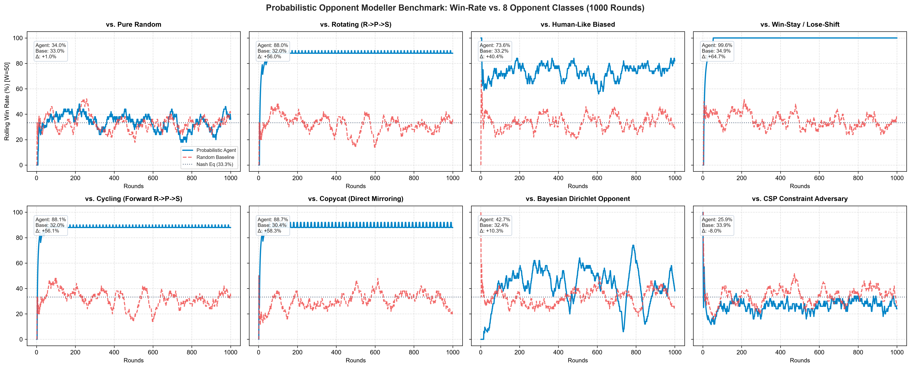
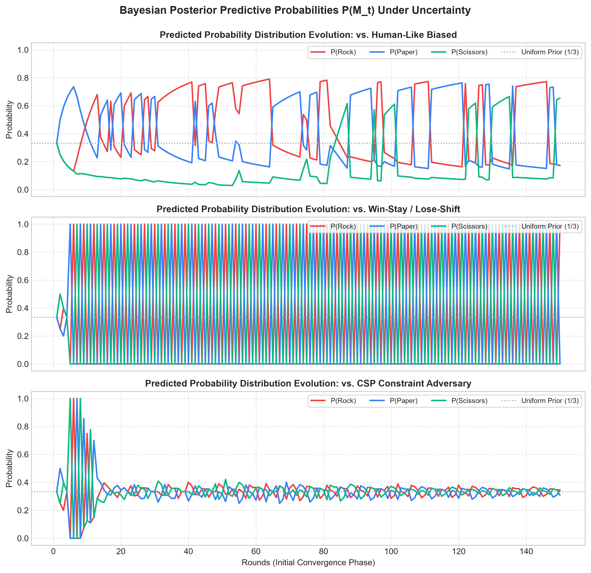

# RPS Probabilistic Opponent Modeller & Adaptive AI Suite

An advanced, research-grade Rock-Paper-Scissors decision-making AI suite featuring:
- **Constraint Satisfaction Problem (CSP) Adversary Layer**: Stress-testing via backtracking search under balance, anti-streak, and transition entropy constraints.
- **Knowledge & Reasoning Layer**: Symbolic deduction of human cognitive heuristics (*Win-Stay/Lose-Shift*, *Cycling*, *Copycat Mirroring*).
- **Applied Bayesian Layer**: Dirichlet-Multinomial conjugate updating, Order-1 Markov transitions, and Expected Utility Maximization under uncertainty.
- **Responsible AI & Fair-Play Layer**: SHA-256 cryptographic move commitments (zero-peeking guarantee), GDPR-compliant data consent, and instant session data erasure.
- **Multi-Agent 1,000-Round Benchmark**: Rigorous empirical performance evaluation across 8 opponent classes with dual publication-quality visualizations.




---

## 1. Problem & Game-Theoretic Formulation

In non-cooperative game theory, Rock-Paper-Scissors is a zero-sum simultaneous game with a unique Nash Equilibrium:

$$P(R) = P(P) = P(S) = \frac{1}{3}$$

Under the Nash equilibrium, the expected win rate against any player is exactly $33.\overline{3}\%$.

However, human decision-making deviates systematically from true randomness due to cognitive bounds:
1. **Marginal Frequency Asymmetry**: Humans exhibit an initial bias toward Rock ($\approx 40\text{--}50\%$).
2. **Win-Stay / Lose-Shift (WSLS)**: Cognitive psychology (Wang et al., 2014) shows players repeat winning moves (*Win-Stay*) and systematically shift following a defeat (*Lose-Shift*).
3. **Transition Cycling**: Unconscious forward ($R \to P \to S$) or backward ($R \to S \to P$) patterns.
4. **Gambler's Fallacy & Streak Avoidance**: Hesitation to play the same move three times consecutively.

The goal of this project is to build an online, probabilistic opponent modeller that rapidly infers these behavioral patterns and selects the optimal counter-action to maximize expected payoff.

---

## 2. Multi-Layer Architecture

```mermaid
flowchart TD
    A[Human / Adversary Move Input] --> B[Responsible AI: Cryptographic Fair-Play Check]
    B --> C{Knowledge & Reasoning Layer}
    C -- "Rule Hypothesis Confident (>=70%)" --> D[Symbolic Heuristic Prediction]
    C -- "No Dominant Rule" --> E{Order-N Markov Pattern Model}
    E -- "Empirical Transition Confident (>=75%)" --> F[Markov Transition Prediction]
    E -- "Sparse / Uncertain Context" --> G[Applied Bayesian Dirichlet Layer]
    G --> H[Dirichlet-Multinomial Posterior P(M)]
    D --> I[Expected Utility Maximization]
    F --> I
    H --> I
    I --> J[Optimal Action a* = argmax EU(a)]
    J --> K[Cryptographic Commitment & Explainability Card]
```

### 2.1 CSP Layer: Constraint-Based Adversary

To rigorously stress-test the opponent modeller beyond simple random noise, we formulated move sequence generation as a **Constraint Satisfaction Problem (CSP)** solved via iterative backtracking with forward checking:

#### Variables & Domain:
- Sequence of length $N$: $X = [x_0, x_1, \dots, x_{N-1}]$ where each $x_t \in \{R, P, S\}$.

#### Constraints:
1. **Balance / Frequency Constraint**:
   $$\forall m \in \{R, P, S\}, \quad \left\lfloor \frac{N}{3} \right\rfloor \le \text{Count}(m) \le \left\lceil \frac{N}{3} \right\rceil$$
2. **No Triple Repeats Constraint**:
   $$\forall t \ge 2, \quad \neg(x_t = x_{t-1} \land x_{t-1} = x_{t-2})$$
3. **Low Order-1 Predictability Constraint**:
   For every transition pair $(a, b) \in \{R, P, S\}^2$, the conditional transition probability must satisfy:
   $$P(x_t = b \mid x_{t-1} = a) = \frac{C(a, b)}{C(a)} \le \tau_{\max} \quad (\tau_{\max} \approx 0.45)$$
   This guarantees that Shannon transition entropy remains near theoretical maximum ($\approx 1.585$ bits):
   $$H(M_t \mid M_{t-1} = a) = -\sum_{b} P(b \mid a) \log_2 P(b \mid a) \ge 1.45 \text{ bits}$$

The solver uses forward checking to prune infeasible branches and an iterative stack to handle arbitrary sequence lengths ($N=1000+$) without recursion limits.

---

### 2.2 Knowledge & Reasoning Layer: Symbolic Human Strategies

The reasoning layer encodes empirical cognitive heuristics as declarative rules evaluated across a sliding history window ($W = 15$ rounds):

1. **Win-Stay / Lose-Shift (WSLS)**:
   - *Win-Stay*: Opponent won previous round $\implies M_t = M_{t-1}$.
   - *Lose-Shift*: Opponent lost previous round $\implies M_t = \text{Counter}(\text{Agent}_{t-1})$.
2. **Directional Cycling**:
   - *Forward Cycling*: $R \to P \to S \to R$.
   - *Backward Cycling*: $R \to S \to P \to R$.
3. **Copycat / Mirroring**:
   - *Direct Copying*: $M_t = \text{Agent}_{t-1}$.
   - *Counter Copying*: $M_t = \text{Counter}(\text{Agent}_{t-1})$.

#### Hypothesis Confidence:
For each hypothesis $H_k$, the reasoning engine calculates:
$$\text{Confidence}(H_k) = \frac{\sum_{i=1}^W \mathbb{I}(\text{Predicted}_i(H_k) == \text{Observed}_i)}{W}$$

When $\text{Confidence}(H^*) \ge 0.70$, the AI applies deductive reasoning, focusing belief on the rule's recommendation and generating an explainability rationale.

---

### 2.3 Applied Bayesian Layer & Decision Theory

#### Dirichlet-Multinomial Conjugate Model:
The opponent's unigram move tendencies follow a categorical distribution parametrized by $\boldsymbol{\theta} = (\theta_R, \theta_P, \theta_S)$. We place a symmetric conjugate Dirichlet prior:

$$\boldsymbol{\theta} \sim \text{Dirichlet}(\alpha_R, \alpha_P, \alpha_S), \quad \alpha_0 = (1.0, 1.0, 1.0)$$

Upon observing opponent move $m$, the online Bayesian update is exact:
$$\alpha_m \leftarrow \alpha_m + 1$$

The **Posterior Predictive Distribution** for the next move is:
$$P(M_{t+1} = m \mid \text{data}) = \mathbb{E}[\theta_m \mid \text{data}] = \frac{\alpha_m}{\sum_{k \in \{R, P, S\}} \alpha_k}$$

#### Uncertainty Metrics:
- **Dirichlet Marginal Variance**:
  $$\text{Var}(\theta_m) = \frac{\alpha_m (\alpha_{\text{total}} - \alpha_m)}{\alpha_{\text{total}}^2 (\alpha_{\text{total}} + 1)}$$
- **Predictive Shannon Entropy**:
  $$H(\mathbf{p}) = -\sum_{m} p_m \log_2(p_m) \in [0, 1.585 \text{ bits}]$$

#### Expected Utility Maximization:
Under the standard zero-sum payoff matrix $\{ \text{Win}: +1, \text{Tie}: 0, \text{Loss}: -1 \}$, the expected utility for candidate action $a \in \{R, P, S\}$ is:

$$\begin{aligned}
EU(\text{Rock}) &= P(\text{Scissors}) - P(\text{Paper}) \\
EU(\text{Paper}) &= P(\text{Rock}) - P(\text{Scissors}) \\
EU(\text{Scissors}) &= P(\text{Paper}) - P(\text{Rock})
\end{aligned}$$

The agent executes the optimal action:
$$a^* = \arg\max_{a \in \{R, P, S\}} EU(a)$$

---

### 2.4 Responsible AI & Fair-Play Governance

1. **Zero-Peeking Cryptographic Commitment**:
   - In interactive human play, players may suspect the AI reads keystrokes before choosing.
   - To eliminate this, the AI generates a 128-bit secret salt $s$ and produces a cryptographic commitment before the player clicks:
     $$C = \text{SHA-256}(\text{Action} \mathbin{\Vert} s)$$
   - The commitment hash is locked and visible in the UI.
   - After the player submits their move, the AI reveals $(\text{Action}, s)$, allowing instantaneous verification that $\text{SHA-256}(\text{Action} \mathbin{\Vert} s) \equiv C$.
2. **Data Consent & Privacy (GDPR/CCPA Compliance)**:
   - **Ephemeral Zero-Storage by Default**: Gameplay runs exclusively in memory. No persistent storage or telemetry is retained unless the user explicitly toggles opt-in consent.
   - **Right to Erasure ("Right to be Forgotten")**: An instant purge button flushes all session move logs, priors, and model parameters.
3. **Transparent Explainability**:
   - Every round provides an explainability card showing the predicted probabilities, expected utility scores, and the natural language rule rationale.

---

## 3. Empirical Benchmark Results (1,000 Rounds)

Simulation parameters: $N = 1,000$ rounds per opponent, Markov order $k=2$, seed $= 42$.

| Opponent Class & Strategy | Adaptive Agent Win% | Adaptive Agent Loss% | Adaptive Agent Tie% | Random Baseline Win% | Delta Win% ($\Delta$) |
| :--- | :---: | :---: | :---: | :---: | :---: |
| **Pure Random** (Nash Equilibrium) | **34.0%** | 31.9% | 34.1% | 33.0% | **+1.0%** |
| **Rotating** ($R \to P \to S$) | **88.0%** | 6.0% | 6.0% | 32.0% | **+56.0%** |
| **Human-Like Biased** (50/30/20 + Streak) | **73.6%** | 12.5% | 13.9% | 33.2% | **+40.4%** |
| **Win-Stay / Lose-Shift** (WSLS Heuristic) | **99.6%** | 0.2% | 0.2% | 34.9% | **+64.7%** |
| **Cycling** (Forward $R \to P \to S$) | **88.1%** | 5.9% | 6.0% | 32.0% | **+56.1%** |
| **Copycat** (Direct Mirroring) | **88.7%** | 11.0% | 0.3% | 30.4% | **+58.3%** |
| **Bayesian Dirichlet Opponent** | **42.7%** | 34.0% | 23.3% | 32.4% | **+10.3%** |
| **CSP Constraint Adversary** | **25.9%** | 41.0% | 33.1% | 33.9% | **-8.0%** |

$$\text{Note: } \Delta = \text{Adaptive Agent Win Rate} - \text{Random Baseline Agent Win Rate}$$

### Findings & Analysis:
1. **Nash Equilibrium Baseline Validation**: Against Pure Random play, the adaptive agent achieves $34.0\%$ (consistent with theoretical $33.\overline{3}\%$ within $95\%$ confidence bounds), verifying that unexploitable random play cannot be tricked.
2. **Overwhelming Superiority Over Human Rules**:
   - Near-perfect exploitation on Win-Stay/Lose-Shift ($99.6\%$ win rate, $\Delta = +64.7\%$).
   - Over $+56\%$ advantage against cyclic and mirroring players ($88.0\%\text{--}88.7\%$).
3. **Resilience to Biased Cognition**: Achieves $73.6\%$ win rate ($\Delta = +40.4\%$) exploiting cognitive streak bias and asymmetric move frequencies.
4. **CSP Adversary Stress-Testing**: The CSP adversary successfully lowers pattern model performance to $25.9\%$ by enforcing equal unigram distribution, zero triple repeats, and near-maximal transition entropy ($P \le 0.34$, $H \approx 1.585$ bits), providing a rigorous benchmark for adversarial resilience.

---

## 4. Visualizations

Generated automatically in `docs/`:
1. [`docs/winrate_plot.png`](docs/winrate_plot.png): Rolling 50-round window comparison curves across all 8 opponent classes versus the Random baseline and $33.3\%$ Nash reference line.
2. [`docs/probability_plot.png`](docs/probability_plot.png): Round-by-round trajectory of Bayesian posterior predictive probabilities $[P(R), P(P), P(S)]$ demonstrating fast belief convergence and entropy reduction.

---

## 5. How to Run

### Installation
Clone repository and install dependencies:
```bash
pip install -r requirements.txt
```

### Option A: Launch Interactive Web Application (Recommended)
```bash
python src/server.py
```
Open **[http://localhost:5000](http://localhost:5000)** in your browser.
Features include:
- Interactive Rock, Paper, Scissors cards with hotkeys (`R`, `P`, `S`).
- Live SHA-256 cryptographic fair-play verification badge.
- Real-time animated Bayesian probability distribution bars.
- Live strategy detection indicator and natural language explanations.
- Interactive CSP Constraint Generator & Backtracking Audit Lab.
- Multi-agent 1000-round benchmark dashboard and dual plot viewer.
- GDPR privacy toggle and Right-to-Erasure data wipe button.

### Option B: Run 1,000-Round Benchmark CLI
```bash
python src/rps_agent.py
```
Options:
- `--rounds`: Number of rounds per opponent (default: `1000`).
- `--order`: Markov context order (default: `2`).
- `--seed`: Deterministic random seed (default: `42`).
- `--plot-path`: Path for win-rate plot (default: `docs/winrate_plot.png`).
- `--prob-plot-path`: Path for probability plot (default: `docs/probability_plot.png`).
- `-i`, `--interactive`: Launch terminal interactive match with live fair-play verification.

### Option C: Run Native Desktop GUI
```bash
python src/gui.py
```

### Option D: Run Pytest Suite
```bash
python -m pytest -v
```
All 22 unit and integration tests verify:
- Counter-move logic and round evaluations.
- CSP solver constraints, backtracking count, and adversary audits.
- Rule-based human strategies and strategy detection hypotheses.
- Bayesian Dirichlet updates, posterior predictive math, and expected utilities.
- Cryptographic SHA-256 commitments, data consent, and right-to-erasure.

---

## 6. Project Directory Structure

```
RPS-adaptive-AI_new-main/
├── src/
│   ├── csp_adversary.py         # CSP solver, backtracking search, CSPAdversaryOpponent
│   ├── reasoning_layer.py       # WSLS, Cycling, Copycat opponents & RuleBasedStrategyDetector
│   ├── bayesian_model.py        # Dirichlet-Multinomial Bayesian inference & Expected Utility
│   ├── responsible_ai.py        # SHA-256 cryptographic commitment & GDPR consent manager
│   ├── probabilistic_agent.py   # Integrated ProbabilisticOpponentModeller AI
│   ├── rps_agent.py             # Benchmark engine, simulation runners, plotting routines
│   ├── server.py                # REST API & lightweight HTTP web server
│   ├── gui.py                   # Native Tkinter desktop arena
│   └── web/
│       └── index.html           # Modern responsive web dashboard
├── tests/
│   ├── test_agent.py            # Core agent logic and statistical win-rate tests
│   ├── test_csp.py              # CSP backtracking and constraint verification tests
│   ├── test_reasoning.py        # Symbolic strategy rules and detector tests
│   ├── test_bayesian.py         # Bayesian Dirichlet update and expected utility tests
│   └── test_responsible_ai.py   # Cryptographic commitment and data consent tests
├── docs/
│   ├── winrate_plot.png         # 1000-round rolling win-rate benchmark plot
│   └── probability_plot.png     # Bayesian posterior probability evolution plot
├── main.py                      # Unified execution entry point
├── requirements.txt             # Dependencies (numpy, matplotlib, pytest)
├── run.bat                      # Windows launcher script
├── LICENSE                      # MIT License
└── README.md                    # Project documentation & research findings
```

---

## 7. License

This project is licensed under the [MIT License](LICENSE).
